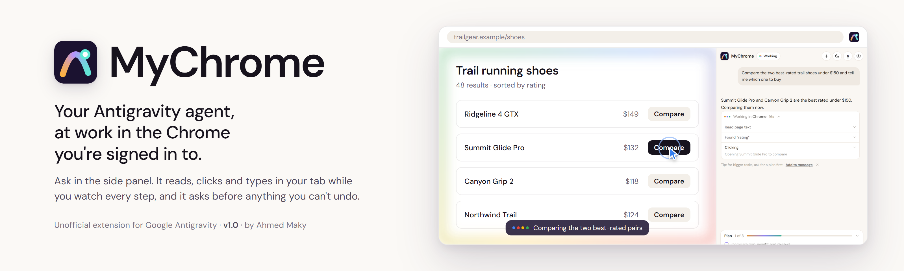
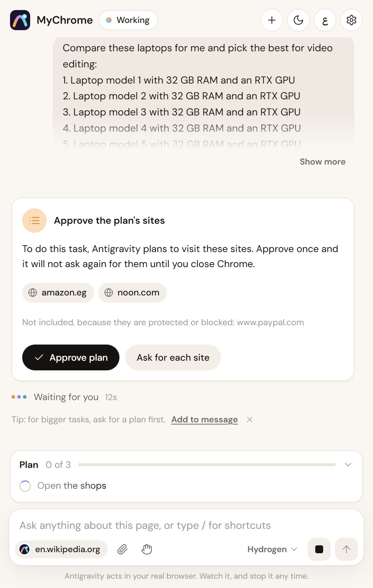
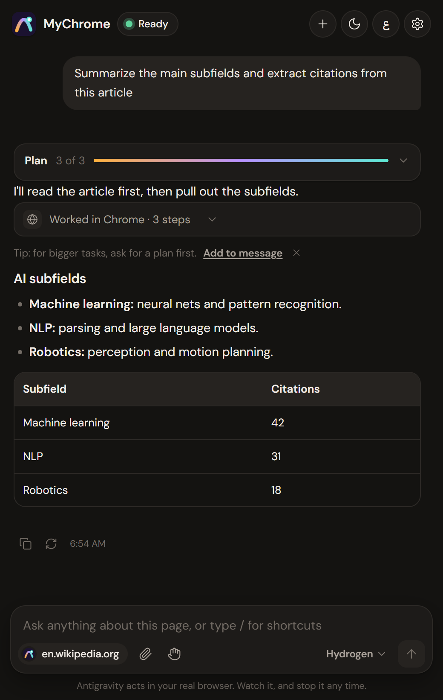
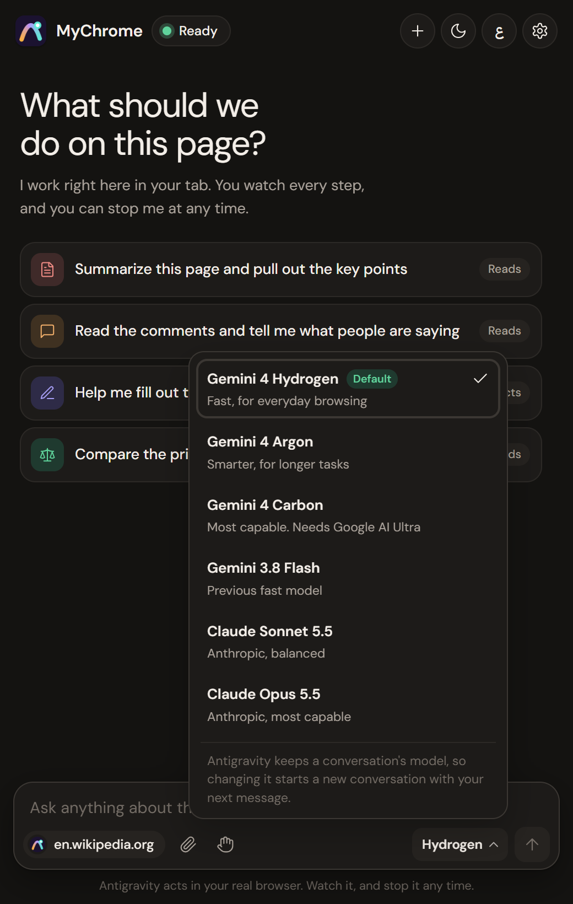
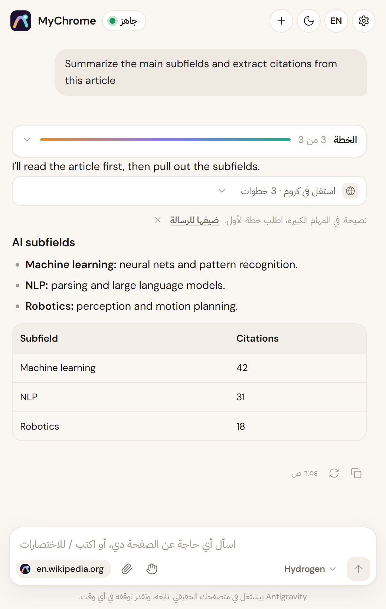

<p align="center">
  <picture>
    <source media="(prefers-color-scheme: dark)" srcset="docs/brand/banner-dark.png">
    
  </picture>
</p>

# MyChrome

Your Google Antigravity agent, at work in the Chrome you're signed in to. You ask in a side panel, and the agent reads, clicks, types and scrolls in your tab while you watch every step.

MyChrome is a free, unofficial extension for Google Antigravity. Version 1.0.

[العربية](#بالعربية)

<p align="center">
  
  
  
</p>

## What it does

- **Works where you are signed in.** The agent uses your own Chrome, so it can read and act on Gmail, LinkedIn, Notion or your company dashboards.
- **Shows you everything.** A soft glow lights the tab it is working in, an arrow glides to each click, its icon in the tab strip says whether it is working, needs you, or is done, and every step appears in the panel with its reason.
- **Asks before it acts.** Approve a plan's sites once instead of site by site. It asks before anything you can't undo, like sending, paying or deleting, never types passwords or card numbers, and stays away from banking and payment sites unless you allow them.
- **Fast.** It batches steps it can predict, reads pages in a compact form, and doesn't wait for every ad to load.
- **Pick the model.** Gemini 4 Hydrogen by default, or Argon, Carbon, Gemini 3.8 Flash, Claude Sonnet 5.5 or Opus 5.5, for the chats you start from the panel.
- **Saves you typing.** Type `/` for your saved prompts, set standing instructions once, select text in an answer to quote it, and attach files or a screenshot of the tab.
- **Stays out of the way.** Notifications only when Chrome is in the background, Alt+Shift+M to open the panel, English and Arabic, light and dark.
- **Helps you debug.** It reads the console errors and failed network requests of the tab you are testing.

## Requirements

Google Antigravity, installed, signed in and open, and Google Chrome on Windows, macOS or Linux.

## Install

**1. Ask Antigravity to install it.** Paste this into a new Antigravity conversation and click **Allow** when it asks:

```text
Please install MyChrome for me.
On Windows run:   irm https://raw.githubusercontent.com/ahmeddmakyy/antigravity-chrome-extension/main/install.ps1 | iex
On macOS/Linux:   curl -fsSL https://raw.githubusercontent.com/ahmeddmakyy/antigravity-chrome-extension/main/install.sh | bash
Then show me the full result.
```

**2. Add the extension to Chrome.** Open `chrome://extensions`, turn on **Developer mode**, click **Load unpacked** and choose the folder the installer copied for you (`~/.gemini/mychrome/extension`). Keep that folder where it is: Chrome loads the extension from it.

**3. Start.** Restart Antigravity and click the MyChrome icon on any tab, or press Alt+Shift+M. There is nothing to pair: the panel shows **Ready** a moment after Antigravity is open.

When you write in the panel, MyChrome starts its own Antigravity conversation with the model you picked. You can also start from Antigravity: type `/mychrome` and your task, for example `/mychrome summarize my unread Gmail`, and it opens Chrome and does it with that conversation's model.

To update, run the same install message again: it replaces the extension and helper files and keeps your settings. When a new version is out, the panel shows **New version available** with a link to its release notes.

To uninstall, paste this into Antigravity:

```text
Please uninstall MyChrome.
On Windows run:   & ([scriptblock]::Create((irm https://raw.githubusercontent.com/ahmeddmakyy/antigravity-chrome-extension/main/install.ps1))) -Uninstall
On macOS/Linux:   curl -fsSL https://raw.githubusercontent.com/ahmeddmakyy/antigravity-chrome-extension/main/install.sh | bash -s -- --uninstall
```

Then remove the extension in `chrome://extensions`.

<details>
<summary>What the installer changes</summary>

| Location | Contents |
|---|---|
| `~/.gemini/mychrome/` | The extension, the helper and the files you attach |
| `~/.gemini/config/plugins/mychrome/` | The Antigravity plugin: skill, helper registration, Stop hook |
| `~/.gemini/config/sidecars/mychrome-waker/` | Wakes the agent when you write in the panel |
| `~/.gemini/config/config.json` | One entry that turns the sidecar on (backed up first) |
| `~/.gemini/config/hooks.json`, `mcp_config.json` | Old MyChrome entries from earlier installs are removed (backed up first) |

The installer checks every download against its published SHA-256 checksum. Uninstalling removes `~/.gemini/mychrome/` completely (extension, helper, key, attachments and logs) and the plugin and sidecar folders.

MyChrome never reads your Antigravity sign-in. It uses Antigravity's documented plugins, MCP servers, hooks and sidecars.
</details>

<details>
<summary>Troubleshooting</summary>

| You see | Fix |
|---|---|
| **Offline** | Open Antigravity, or quit it completely and open it again. |
| **Not linked** | Write in the panel, or type `/mychrome` once in an Antigravity conversation. |
| A banner about an old version | Click **Reload** on MyChrome in `chrome://extensions`. |
| "Waiting for you" with no card | Antigravity may be waiting for you to approve a tool in its own window. |
| Chrome cannot load the extension | The folder was moved or deleted. Repeat install steps 1 and 2. |
</details>

<details>
<summary>FAQ</summary>

**Is this an official Google Antigravity extension?**
No. MyChrome is an independent project by Ahmed Maky. Google, Chrome and Google Antigravity are trademarks of Google LLC.

**Does it use my Google AI subscription?**
It uses your own Antigravity app, so your Antigravity plan's limits apply. Some models, like Gemini 4 Carbon, need a higher plan.

**Where does my data go?**
Only to your Antigravity app on your computer. Files you attach are saved in `~/.gemini/mychrome/uploads` and deleted after 7 days. MyChrome has no server and collects no analytics. See [PRIVACY.md](PRIVACY.md).
</details>

## License

MyChrome is open source: its code is public so you can see that nothing is hidden and exactly what it does on your computer. The 1.0 release was audited before publishing; see [docs/AUDIT-1.0.md](docs/AUDIT-1.0.md). It is not free to reuse. **Copyright © 2026 Ahmed Maky. All rights reserved.**

You may install and use MyChrome for yourself, read its code, and ask an AI assistant to explain it or check its security. Copying, modifying or redistributing it, rebuilding or cloning it, and having AI copy, rewrite or generate code from it, or train on it, are not allowed without written permission. Read the full terms in [LICENSE](LICENSE). Third-party components keep their own licenses, listed in [THIRD_PARTY_NOTICES.md](THIRD_PARTY_NOTICES.md).

## Credits

Built by Ahmed Maky.

<p>
  <a href="https://www.linkedin.com/in/ahmeddmakyy11"> LinkedIn</a>
  &nbsp;·&nbsp;
  <a href="https://ahmeddmakyy.vercel.app"> Portfolio</a>
  &nbsp;·&nbsp;
  <a href="https://t.me/ahmeddmakyy"> Telegram</a>
</p>

---

<div dir="rtl">

## بالعربية

**MyChrome** بيخلّي وكيل Google Antigravity يشتغل جوه Chrome اللي انت مسجّل دخول فيه. بتكلّمه من شريط جانبي، وهو بيقرا ويضغط ويكتب وينزل في التاب بتاعك وانت شايف كل خطوة. إضافة مجانية وغير رسمية لـ Google Antigravity، الإصدار 1.0.

<p align="center">
  
</p>

### بيعمل إيه

- **بيشتغل في حساباتك.** بيستخدم Chrome بتاعك، فيقدر يقرا ويتعامل مع Gmail وLinkedIn وNotion ولوحات شركتك.
- **بيوريك كل حاجة.** توهج هادي حوالين التاب اللي شغال فيه، وسهم بيتحرك لكل ضغطة، وأيقونة التاب بتقولك هو شغال ولا محتاجك ولا خلص، وكل خطوة بتظهر في الشريط بسببها.
- **بيستأذن قبل ما يتصرف.** توافق على مواقع الخطة مرة واحدة بدل كل موقع لوحده. وبيسألك قبل أي حاجة ما ينفعش ترجع فيها زي الإرسال أو الدفع أو الحذف، وعمره ما بيكتب باسوردات أو أرقام كروت، وبيبعد عن مواقع البنوك والدفع إلا لو انت سمحت.
- **سريع.** بيجمّع الخطوات اللي يقدر يتوقعها، وبيقرا الصفحات بشكل مختصر، ومش بيستنى كل الإعلانات تحمّل.
- **اختار الموديل.** الافتراضي Gemini 4 Hydrogen، ومعاه Argon وCarbon وGemini 3.8 Flash وClaude Sonnet 5.5 وOpus 5.5، للمحادثات اللي بتبدأها من الشريط.
- **بيوفّر عليك الكتابة.** اكتب `/` لطلباتك المحفوظة، وحط تعليمات ثابتة مرة واحدة، وحدد كلام في الرد عشان تقتبسه، وارفق ملفات أو صورة للتاب.
- **مش بيزعجك.** الإشعارات بس لما Chrome يكون في الخلفية، وAlt+Shift+M بيفتح الشريط، وفيه عربي وإنجليزي وفاتح وغامق.

### المتطلبات

Google Antigravity متثبّت ومسجّل دخول ومفتوح، وGoogle Chrome على Windows أو macOS أو Linux.

### التثبيت

1. **اطلب من Antigravity يثبّتها.** الصق رسالة التثبيت اللي في قسم [Install](#install) في محادثة جديدة في Antigravity، واضغط **Allow** لما يطلب الإذن.
2. **ضيف الإضافة لـ Chrome.** افتح `chrome://extensions`، وفعّل **Developer mode**، واضغط **Load unpacked**، واختار الفولدر اللي المثبّت نسخه (`~/.gemini/mychrome/extension`). سيب الفولدر ده مكانه، لأن Chrome بيحمّل الإضافة منه.
3. **ابدأ.** اقفل Antigravity وافتحه تاني، واضغط أيقونة MyChrome على أي تاب أو اضغط Alt+Shift+M. مفيش أي ربط تعمله: الشريط بيكتب **جاهز** بعد ما Antigravity يفتح بلحظة.

لما تكتب في الشريط، MyChrome بيبدأ محادثة Antigravity خاصة بيه بالموديل اللي اخترته. وتقدر تبدأ من Antigravity نفسه: اكتب `/mychrome` وبعدها المهمة، مثلًا `/mychrome لخّصلي الإيميلات اللي ما اتقريتش`، فيفتح Chrome ويعملها بموديل المحادثة دي.

### الترخيص

MyChrome مفتوح المصدر: الكود منشور عشان تشوف بالظبط هو بيعمل إيه على جهازك، لكنه مش متاح لإعادة الاستخدام. **حقوق النشر © 2026 أحمد مكي. كل الحقوق محفوظة.**

مسموح لك تثبّت MyChrome وتستخدمه لنفسك، وتقرا الكود، وتطلب من أي مساعد ذكاء اصطناعي يشرحه لك أو يراجع أمانه. ممنوع نسخه أو تعديله أو إعادة نشره، أو عمل هندسة عكسية عشان تبني نسخة منه، أو إنك تخلّي الذكاء الاصطناعي ينسخه أو يعيد كتابته أو يولّد كود منه أو يتدرّب عليه، إلا بإذن مكتوب. الشروط كاملة في [LICENSE](LICENSE)، والمكونات الخارجية ليها تراخيصها في [THIRD_PARTY_NOTICES.md](THIRD_PARTY_NOTICES.md).

MyChrome مشروع مستقل ومش تابع لجوجل. Google وChrome وGoogle Antigravity علامات تجارية لشركة Google LLC.

</div>
